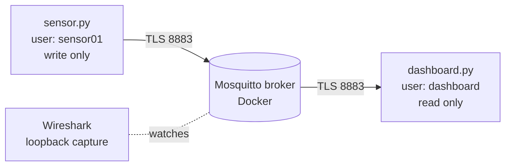

# Securing an IoT Temperature Sensor on MQTT

A simulated temperature sensor sends readings to a Mosquitto MQTT broker, and a dashboard reads them. I start with a wide-open setup, prove in Wireshark that anyone on the network can read the data and even the password, then lock it down in four stages and audit the result against GDPR.



## Results

| Phase | Broker setting | What Wireshark showed |
|---|---|---|
| 1. Open | Port 1883, anonymous allowed | Full JSON reading visible in every PUBLISH packet |
| 2. Login | Username + password | Login works, but the password is readable in the CONNECT packet |
| 3. TLS | Port 8883 only, TLS 1.2+ | Only "Application Data". No MQTT fields, no password, no readings |
| 4. ACL | Per-user topic rules | Sensor cannot read, dashboard cannot write. 4/4 checks pass |
| 5. GDPR | 17-point checklist | 10 met, 4 partial, 3 gaps with fixes ([docs/GDPR_CHECKLIST.md](docs/GDPR_CHECKLIST.md)) |

Key lesson: adding a password (phase 2) without encryption (phase 3) only hands the password to anyone listening.

## Tech

Python 3, paho-mqtt (MQTT v5), Eclipse Mosquitto 2.0 in Docker, Wireshark, X.509 certificates (cryptography library), GDPR Articles 5, 25, 32, 33.

## Project layout

```
docker-compose.yml          broker container; PHASE in .env picks the config
mosquitto/config/           phase1_open, phase2_auth, phase3_tls, phase4_acl, acl
scripts/gen_certs.py        creates the lab CA + server certificate
src/sensor.py               simulated sensor (publisher)
src/dashboard.py            terminal dashboard (subscriber), optional CSV save
src/acl_test.py             proves least-privilege rules work
src/purge_old_data.py       30-day retention for saved readings
docs/GDPR_CHECKLIST.md      GDPR audit
evidence/                   screenshots
```

---

# How to run it (step by step)

Commands marked **Mac** go in Terminal. Commands marked **Windows** go in PowerShell. Run every command from the project folder.

## Step 0: One-time setup

**0.1 Install Docker Desktop**
1. Go to docker.com > Products > Docker Desktop > Download (pick Mac Apple chip / Intel, or Windows).
2. Install and open it. Wait until the whale icon says "Docker Desktop is running".

**0.2 Install Wireshark**
1. Go to wireshark.org > Download.
2. **Mac:** open the .dmg, drag Wireshark to Applications, then double-click **Install ChmodBPF.pkg** in the same window (this lets Wireshark capture without sudo). Log out and back in.
3. **Windows:** run the installer. When the Npcap screen appears, tick **Support loopback traffic ("Npcap Loopback Adapter" will be created)**.

**0.3 Install Python 3.10+** from python.org if `python3 --version` (Mac) or `py --version` (Windows) shows nothing.

**0.4 Set up the project**

Mac:
```bash
cd mqtt-iot-security
python3 -m venv .venv
source .venv/bin/activate
pip install -r requirements.txt
cp .env.example .env
```
Windows:
```powershell
cd mqtt-iot-security
py -m venv .venv
.venv\Scripts\Activate.ps1
pip install -r requirements.txt
copy .env.example .env
```
If PowerShell blocks the activate script, run `Set-ExecutionPolicy -Scope CurrentUser RemoteSigned` once, type Y, then activate again.

Open `.env` in VS Code and change both passwords to something new (lab-only, not a real password).

**0.5 Open two terminals side by side.** In VS Code: Terminal > New Terminal, then click the split icon (square with a line) at the top right of the terminal panel. Activate the venv in both. Left = sensor, right = dashboard.

---

## Phase 1: Prove the data is readable

1. In `.env`, confirm `PHASE=phase1_open`.
2. Start the broker:
   ```bash
   docker compose up -d
   docker compose logs mosquitto
   ```
   You should see `Opening ipv4 listen socket on port 1883`.
3. Open Wireshark. Double-click **Loopback: lo0** (Mac) or **Adapter for loopback traffic capture** (Windows).
4. In the filter bar at the top, type `mqtt` and press Enter.
5. Right terminal: `python src/dashboard.py`
6. Left terminal: `python src/sensor.py`
7. In Wireshark, click any row that says **Publish Message**. In the middle pane, expand **MQ Telemetry Transport Protocol**. The **Message** line shows the full JSON reading in plain text.
8. Screenshot it as `evidence/01_plaintext_payload.png`.
9. Press Ctrl+C in both terminals.

## Phase 2: Add username and password

1. Create the password file (replace the passwords with the ones in your `.env`):
   ```bash
   docker compose run --rm mosquitto mosquitto_passwd -c -b /mosquitto/config/passwd sensor01 YOUR_SENSOR_PASS
   docker compose run --rm mosquitto mosquitto_passwd -b /mosquitto/config/passwd dashboard YOUR_DASHBOARD_PASS
   ```
   `-c` creates the file, so use it only on the first line. Open `mosquitto/config/passwd` and note you see hashes, not passwords.
2. In `.env`, set `PHASE=phase2_auth` and save.
3. Restart the broker: `docker compose up -d --force-recreate`
4. Left terminal, try without logging in: `python src/sensor.py`. It should say **broker refused the connection: Not authorized**. Screenshot as `02_anonymous_refused.png`.
5. Now log in properly:
   - Right: `python src/dashboard.py --auth`
   - Left: `python src/sensor.py --auth`
6. In Wireshark, filter `mqtt.msgtype == 1` (CONNECT packets). Click one, expand **MQ Telemetry Transport Protocol**. You will see **User Name** and **Password** in clear text. Screenshot as `02_plaintext_password.png`. This is the whole reason for phase 3.
7. Ctrl+C both terminals.

## Phase 3: Turn on TLS (port 8883)

1. Generate certificates: `python scripts/gen_certs.py`
2. In `.env`, set `PHASE=phase3_tls`, save, then `docker compose up -d --force-recreate`
3. Check the logs: `docker compose logs mosquitto` should show port 8883 only.
4. Run both with TLS:
   - Right: `python src/dashboard.py --auth --tls --save`
   - Left: `python src/sensor.py --auth --tls`
5. In Wireshark, filter `tcp.port == 8883`. Rows now say **TLSv1.3** (or 1.2) and **Application Data**. Click one: no MQTT section, no message, no password. Screenshot as `03_tls_encrypted.png`.
6. Right-click any of those packets > **Follow** > **TCP Stream**. The window shows unreadable bytes. Screenshot as `03_follow_stream.png`, close it.
7. Bonus proof: type `mqtt` in the filter. Nothing shows, because Wireshark can no longer see inside.
8. Leave the sensor running a minute so the dashboard saves some rows, then Ctrl+C both.
9. Run the access test now, before rules exist: `python src/acl_test.py`. Expect **2/4**: the sensor can still read and the dashboard can still write. Screenshot as `04_acl_before.png`.

## Phase 4: Access rules (sensor only sends, dashboard only reads)

1. Open `mosquitto/config/acl` and read the rules (2 users, 1 rule each).
2. In `.env`, set `PHASE=phase4_acl`, save, then `docker compose up -d --force-recreate`
3. Run `python src/acl_test.py`. Expect **4/4 least-privilege checks passed**. Screenshot as `04_acl_after.png`.
4. See the broker refusing: `docker compose logs mosquitto | grep -i denied` (Windows: `docker compose logs mosquitto | Select-String denied`). Screenshot as `04_broker_denied_log.png`.
5. Run sensor and dashboard once more with `--auth --tls` to confirm normal flow still works.

## Phase 5: GDPR check

1. Read `docs/GDPR_CHECKLIST.md` and confirm each "Evidence" item matches your screenshots.
2. Run the retention rule: `python src/purge_old_data.py --days 30`
3. Update any row where your setup differs.

## Shut down

```bash
docker compose down
```

## Push to GitHub

1. github.com > top right **+** > **New repository** > name `mqtt-iot-security` > Public > **Create repository** (do not add a README there).
2. In the project folder:
   ```bash
   git init
   git add .
   git status
   ```
   Check that `.env`, `passwd`, and `mosquitto/certs/` are NOT in the list.
3. Then:
   ```bash
   git commit -m "MQTT IoT security lab: auth, TLS, ACL, GDPR audit"
   git branch -M main
   git remote add origin https://github.com/YOUR_USERNAME/mqtt-iot-security.git
   git push -u origin main
   ```

## Troubleshooting

| Problem | Fix |
|---|---|
| `could not connect ... Connection refused` | Broker not running or wrong phase. Run `docker compose ps` and check `PHASE` in `.env` |
| `certificate verify failed` | Re-run `python scripts/gen_certs.py`, then `docker compose up -d --force-recreate` |
| `Not authorized` with `--auth` | Password in `.env` does not match what you gave `mosquitto_passwd`. Re-run both passwd commands |
| Wireshark shows no packets | Wrong interface. Pick the loopback one, not Wi-Fi |
| Broker warns passwd file is world readable | Expected in this lab, safe to ignore |
